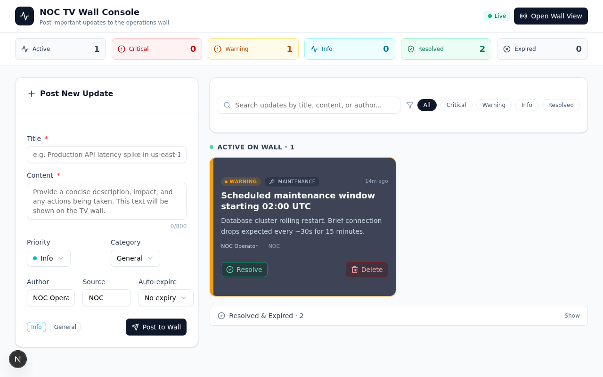
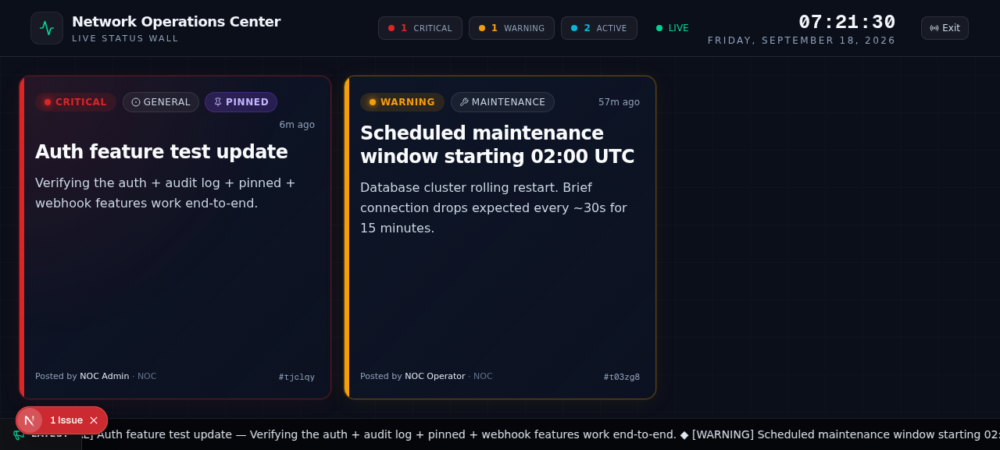
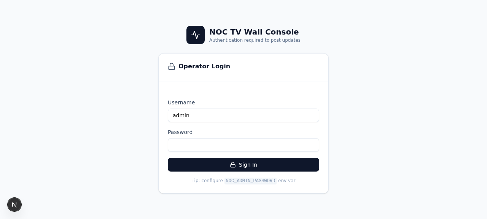
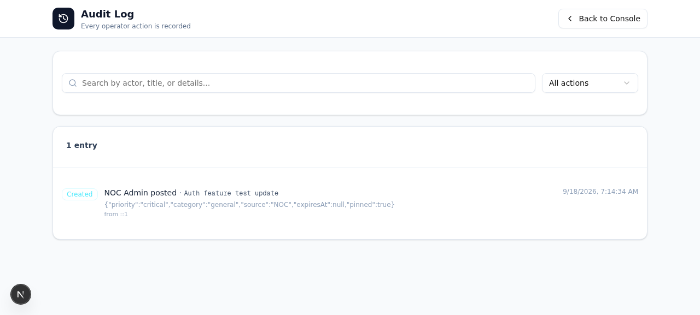

# NOC TV Wall

A real-time broadcast system for posting important operational updates to a Network Operations Center TV wall. Built for ops/SRE/NOC teams that need a single place to push incident notices, maintenance windows, and announcements — and have them appear instantly on every wall display in the room.









---

## Features

### Two integrated views (single-page app)

- **Operator Console** (`/` or `?view=console`) — authenticated control panel where operators post new updates and manage active/resolved ones.
- **TV Wall Display** (`?view=wall`) — public, full-screen, dark-themed view designed for big-screen displays. No auth required so it can stay open on a TV in the NOC.

### Updates

- **Priorities**: `Critical`, `Warning`, `Info`, `Success` — each with its own accent color.
- **Categories**: `Incident`, `Maintenance`, `Announcement`, `General`.
- **Auto-expiry**: optional presets (15m / 30m / 1h / 4h / 8h / 24h). Active updates past their expiry are auto-expired server-side.
- **Pin to top**: critical updates can be pinned so they always stay at the top of the wall even when new updates arrive.
- **Resolve / Reactivate / Delete**: full lifecycle management from the operator console.

### Real-time sync (WebSocket)

- A dedicated socket.io mini-service broadcasts every create/resolve/reactivate/delete/pin/unpin event to every connected client instantly.
- The operator console and the wall display stay in sync within milliseconds — no polling required for live updates.
- Polling fallback (every 20s on the wall, 30s on the console) catches up if a WS event is missed.

### TV Wall display

- Live clock + date in the header.
- Status pills showing Critical / Warning / Active counts.
- `LIVE` / `Reconnecting` connection indicator.
- Color-coded cards with accent bars and pulse animation for critical updates.
- Auto-pagination every 12s when there are more than 6 active updates.
- Bottom ticker with all active updates scrolling.
- Esc to exit back to the console.
- Responsive: 1 / 2 / 3 columns at mobile / tablet / desktop.

### Authentication (NextAuth.js credentials provider)

- Single shared admin password (via `NOC_ADMIN_PASSWORD` env var) — or multi-user via `NOC_USERS=username:password,username2:password2`.
- 24-hour JWT session.
- Public GET endpoints (wall display can fetch updates without auth); mutations require session.
- Login failures and successes are recorded in the audit log.

### Audit log

- Every operator action is persisted: `create`, `resolve`, `reactivate`, `delete`, `pin`, `unpin`, `login`, `login_failed`.
- Search by actor, title, or details. Filter by action. Paginated.
- Each entry records the actor name, target update, full details JSON, originating IP, and timestamp.

### Slack / Teams webhook (optional)

- Set `SLACK_WEBHOOK_URL` (or `WEBHOOK_URL`) to mirror new/resolved/reactivated/deleted updates to a Slack-compatible incoming webhook.
- Works with Slack, Microsoft Teams (via Slack-compatible webhook connector), Mattermost, and Discord.
- Payload is formatted as Slack Block Kit with priority color, author, source, and a "View on Wall" button.

### Operator console

- Sticky header with **Open Wall View**, **Audit Log**, and **Sign out** buttons.
- Stats bar: Active / Critical / Warning / Info / Pinned / Resolved / Expired.
- Post form with live preview chips.
- Active updates grid with color-coded cards and inline Resolve / Pin / Unpin / Delete actions.
- Collapsible Resolved & Expired section with Reactivate option.
- Search + priority filter chips.

---

## Quick start (Docker Compose) — recommended

### Prerequisites

- Docker 24+ and Docker Compose v2+

### Steps

```bash
# 1. Clone / download the project, then:
cd noc-tv-wall

# 2. Create your .env file from the template
cp .env.example .env

# 3. Generate a strong NextAuth secret and edit .env:
#    - Replace NEXTAUTH_SECRET (e.g. `openssl rand -base64 32`)
#    - Set NOC_ADMIN_PASSWORD to something other than the default
#    - (Optional) Set SLACK_WEBHOOK_URL for Slack/Teams mirroring
vi .env

# 4. Build and start the stack
docker compose up --build -d

# 5. Open the operator console
open http://localhost:8080
#    Log in with username: admin, password: (whatever you set in NOC_ADMIN_PASSWORD)

# 6. Open the wall display in a separate browser tab/window (or another machine)
open http://localhost:8080/?view=wall
```

### Useful commands

```bash
# View logs (all services)
docker compose logs -f

# View logs for one service
docker compose logs -f app
docker compose logs -f ws
docker compose logs -f caddy

# Restart a single service
docker compose restart app

# Stop everything (database is persisted in a named volume)
docker compose down

# Stop and wipe the database volume
docker compose down -v
```

### Port mapping

| Host port | Container port | Service | Purpose |
|----------|----------------|---------|---------|
| `8080`   | `80`           | caddy   | Public entry point — open this in your browser |
| (internal) | `3000`       | app     | Next.js standalone server |
| (internal) | `3003`       | ws      | socket.io WebSocket server |

To change the public port, edit the `ports:` mapping for `caddy` in `docker-compose.yml`.

---

## Local development (without Docker)

### Prerequisites

- Node.js 20+
- Bun 1.0+ (for package install and the WS service)
- SQLite (included in the Prisma SQLite engine)

### Steps

```bash
# 1. Install dependencies
bun install

# 2. Configure env
cp .env.example .env
# Edit .env (NEXTAUTH_SECRET, NOC_ADMIN_PASSWORD)

# 3. Push the Prisma schema to the SQLite database
bun run db:push

# 4. Start the dev server (Next.js on :3000)
bun run dev

# 5. In a separate terminal, start the WebSocket mini-service
cd mini-services/noc-wall
bun install
bun run dev
# This serves socket.io on port 3003

# 6. Open http://localhost:3000
```

The Caddy gateway that's wired into the Docker setup is not strictly required for local dev — the Next.js app talks to the WS service directly through `/?XTransformPort=3003` which only works if Caddy is in front. For pure local dev, the WS will show "Reconnecting" but everything else works (the polling fallback keeps the wall in sync every 20s).

---

## Environment variables

All configuration is via environment variables, loaded from `.env` by Docker Compose.

| Variable | Required | Default | Description |
|---|---|---|---|
| `DATABASE_URL` | yes | `file:/app/db/custom.db` | SQLite database location. In Docker, this is a mounted volume. |
| `NEXTAUTH_SECRET` | yes | — | Long random string for signing JWTs. Generate with `openssl rand -base64 32`. |
| `NEXTAUTH_URL` | yes | `http://localhost:8080` | Public URL where the app is reachable (used in webhook links and redirects). |
| `NOC_ADMIN_PASSWORD` | yes (or `NOC_USERS`) | — | Password for the single admin user (`admin`). |
| `NOC_ADMIN_NAME` | no | `NOC Admin` | Display name for the admin user. |
| `NOC_USERS` | no | — | Multi-user mode. Format: `alice:alicePass,bob:bobPass`. Overrides `NOC_ADMIN_PASSWORD`. |
| `SLACK_WEBHOOK_URL` | no | — | Slack-compatible incoming webhook URL. When set, updates are mirrored to this channel. Alias: `WEBHOOK_URL`. |

---

## Architecture

```
┌────────────┐         ┌────────────┐         ┌────────────┐
│  Browser   │ ──HTTP─▶│   Caddy    │ ──HTTP──▶│ Next.js    │
│  (operator │         │  (:80)     │         │  app       │
│   console) │         │  :8080     │         │  (:3000)   │
└────────────┘         │            │         └────────────┘
                       │            │                 │
                       │  XTransform│ Port=3003        │ SQLite
                       │  query     │         ┌────────────┐
                       │  → ws:3003 │ ─WS────▶│ socket.io  │
                       │            │         │  ws        │
                       │            │         │  (:3003)   │
┌────────────┐         │            │         └────────────┘
│  Browser   │ ──HTTP─▶│            │
│  (TV wall  │         │            │
│   display) │         │            │
└────────────┘         └────────────┘

                              ┌────────────┐
                              │  Volume    │
                              │  noc-db    │ ← persistent SQLite file
                              └────────────┘
```

- The browser talks only to Caddy on port 80 (host port 8080).
- Caddy routes any request with `?XTransformPort=3003` to the `ws` service; everything else to the `app` service.
- The `app` and `ws` services don't expose ports to the host — they're only reachable via Caddy.
- The SQLite database file lives in a named Docker volume (`noc-db`) so it survives `docker compose down` and container rebuilds.

### Tech stack

- **Framework**: Next.js 16 with App Router and standalone output
- **Language**: TypeScript 5
- **Database**: Prisma ORM with SQLite
- **Realtime**: socket.io (server) + socket.io-client (browser)
- **Auth**: NextAuth.js v4 with credentials provider
- **UI**: Tailwind CSS 4 + shadcn/ui component library
- **Webhook delivery**: Slack Block Kit payloads via fetch
- **Reverse proxy**: Caddy 2

### File structure (key files)

```
.
├── Dockerfile                          # Multi-stage build for the Next.js app
├── docker-compose.yml                  # caddy + app + ws
├── Caddyfile                           # Reverse proxy config
├── .env.example                        # Environment template
├── prisma/
│   └── schema.prisma                   # NocUpdate, NocAuditLog, User, Post
├── src/
│   ├── app/
│   │   ├── page.tsx                     # View toggle (console/wall/login/audit)
│   │   ├── layout.tsx                   # Root layout with AuthProvider
│   │   ├── api/
│   │   │   ├── auth/
│   │   │   │   ├── [...nextauth]/route.ts  # NextAuth handler
│   │   │   │   └── me/route.ts             # GET /api/auth/me
│   │   │   └── noc/
│   │   │       ├── updates/route.ts        # GET (list), POST (create)
│   │   │       ├── updates/[id]/route.ts   # PATCH, DELETE
│   │   │       └── audit/route.ts          # GET audit log
│   ├── components/
│   │   ├── auth-provider.tsx              # Client-side SessionProvider wrapper
│   │   └── noc/
│   │       ├── operator-console.tsx       # Main operator UI
│   │       ├── tv-wall-view.tsx            # Full-screen wall display
│   │       ├── login-view.tsx              # Login form
│   │       ├── audit-log-view.tsx          # Audit log browser
│   │       ├── new-update-form.tsx        # Post new update form
│   │       └── update-card.tsx             # Shared update card
│   ├── hooks/
│   │   └── use-noc-socket.ts              # socket.io client hook
│   ├── lib/
│   │   ├── auth.ts                        # NextAuth options + user parser
│   │   ├── audit.ts                       # Audit log writer
│   │   ├── webhook.ts                     # Slack/Teams webhook sender
│   │   ├── db.ts                          # Prisma client singleton
│   │   └── noc-types.ts                   # Shared types + metadata
│   └── middleware.ts                      # Auth gate on mutation endpoints
└── mini-services/
    └── noc-wall/
        ├── Dockerfile                    # Bun-based WS image
        ├── index.ts                      # socket.io server
        └── package.json
```

---

## API reference

### `GET /api/noc/updates?status=active|resolved|expired|all`
Returns the list of updates, optionally filtered by status. **Public** (no auth).

### `POST /api/noc/updates`
Create a new update. **Requires auth.**
```json
{
  "title": "Production API latency spike",
  "content": "Investigating root cause...",
  "priority": "critical",         // critical | warning | info | success
  "category": "incident",          // incident | maintenance | announcement | general
  "authorName": "NOC Operator",
  "source": "NOC",
  "expiresInMinutes": 60,           // optional
  "pinned": true                    // only effective for critical priority
}
```

### `PATCH /api/noc/updates/:id`
Resolve, reactivate, pin, unpin, or edit an update. **Requires auth.**
```json
// To resolve:
{ "action": "resolve" }
// To reactivate:
{ "action": "reactivate" }
// To pin:
{ "action": "pin" }
// To unpin:
{ "action": "unpin" }
// To edit fields (no action needed):
{ "title": "Updated title", "content": "New content", ... }
```

### `DELETE /api/noc/updates/:id`
Delete an update. **Requires auth.**

### `GET /api/noc/audit?from=&to=&action=&q=&limit=`
Returns audit log entries. **Requires auth.**

### `GET /api/auth/me`
Returns `{ user: { name, username } | null }` for the current session. **Public.**

### `* /api/auth/*`
NextAuth.js standard endpoints (`signin`, `signout`, `session`, `csrf`, `callback/*`, `providers`). See [NextAuth.js docs](https://next-auth.js.org/).

---

## Usage guide

### Typical workflow

1. Open `http://localhost:8080` in your browser → log in.
2. Configure a TV in the NOC to display `http://your-server:8080/?view=wall` (full-screen, kiosk mode).
3. When an incident happens, post a new update from the console. It appears on every wall display instantly.
4. When the incident is mitigated, click **Resolve** — the wall updates instantly to drop the card.
5. For ongoing critical incidents, **Pin** the card so it stays at the top of the wall even as new updates arrive.
6. Need a post-mortem? Open **Audit Log** to see every action with actor, timestamp, and details.

### Multi-operator setup

Set `NOC_USERS=alice:alicePass,bob:bobPass,carol:carolPass` in `.env`. Each operator signs in with their own username. The audit log records who did what.

### Slack/Teams integration

1. Create an incoming webhook in your Slack workspace (or Teams channel via the Slack-compatible connector).
2. Set `SLACK_WEBHOOK_URL=https://hooks.slack.com/services/...` in `.env`.
3. Restart the stack: `docker compose up -d`.
4. New updates are now mirrored to Slack with priority color, author, source, and a "View on Wall" button.

---

## Troubleshooting

### Container `noc-wall-app` fails to start with "Cannot find module 'effect'"
This is a Prisma 6.x CLI dependency issue. The Prisma CLI depends on `@prisma/config`, which in turn depends on `effect`, `c12`, `deepmerge-ts`, and `empathic`. The current `Dockerfile` installs the Prisma CLI fresh in the runner stage via `npm install --omit=dev --no-save prisma@6.19.2` to pull all transitive dependencies.

If you see this error after pulling an older version of the repo:
1. Make sure you have the latest `Dockerfile` (it should contain `RUN npm install --omit=dev --no-save prisma@6.19.2` in the runner stage).
2. Rebuild without cache: `docker compose build --no-cache app && docker compose up -d`.

### The wall view shows "Reconnecting" instead of "LIVE"
- Check that the `ws` service is healthy: `docker compose ps` — all three services should show `(healthy)`.
- Check the ws logs: `docker compose logs ws` — should show `WebSocket server running on port 3003` and `Client connected` lines.
- Check the caddy logs: `docker compose logs caddy` — should not show 502 errors.

### "Failed to fetch audit logs" in the audit log view
- You're not logged in. Click **Back to Console**, sign in, then return to the audit log.

### Login fails with "Invalid username or password"
- Check `NOC_ADMIN_PASSWORD` in `.env` (or `NOC_USERS` if you're using multi-user mode).
- Make sure there are no leading/trailing spaces in the env values.
- Restart the app: `docker compose restart app`.

### Prisma client errors after a schema change
- The Docker image runs `prisma db push --accept-data-loss --skip-generate` at startup, so schema changes are applied automatically.
- If you changed the schema, rebuild: `docker compose up --build -d`.

### Container is stuck "unhealthy" and Caddy never starts
- Check the app logs: `docker compose logs app`. The most common cause is the Prisma CLI failing to start because of a missing transitive dep (see the `effect` note above).
- The app's healthcheck hits `GET /api/noc/updates?status=active` (a public endpoint). If that's not returning 200, the app hasn't started.
- Force a clean rebuild: `docker compose down && docker compose build --no-cache && docker compose up -d`.

### Database persistence
- The SQLite database lives in the `noc-db` Docker volume.
- `docker compose down` keeps the database.
- `docker compose down -v` deletes the database.
- To back up: `docker run --rm -v noc-db:/data alpine tar -czf - -C /data . > noc-backup.tar.gz`
- To restore: `docker run --rm -i -v noc-db:/data alpine tar -xzf - -C /data . < noc-backup.tar.gz`

---

## License

MIT — use this for whatever you want. Attribution appreciated but not required.
